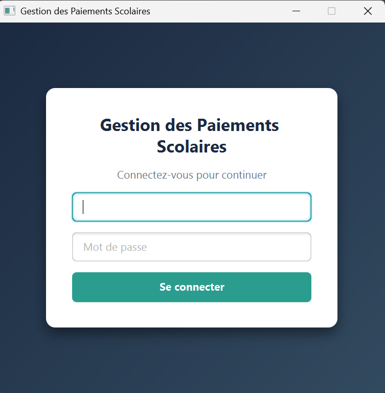
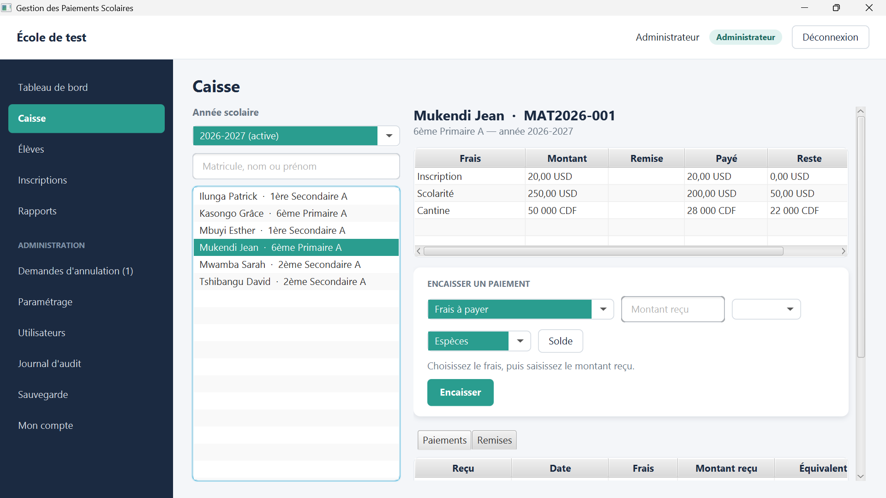
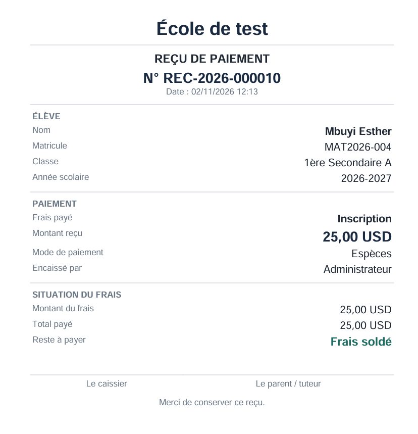
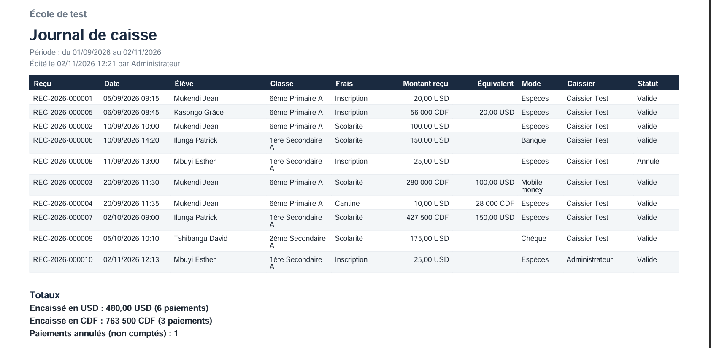
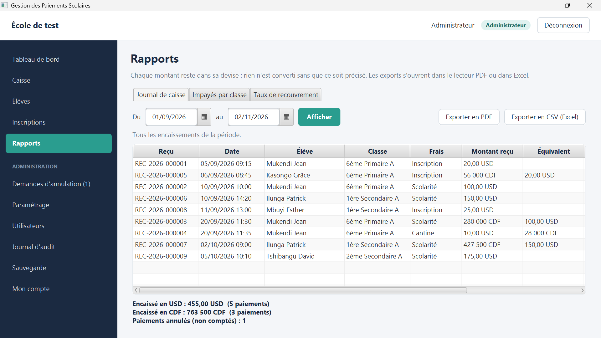
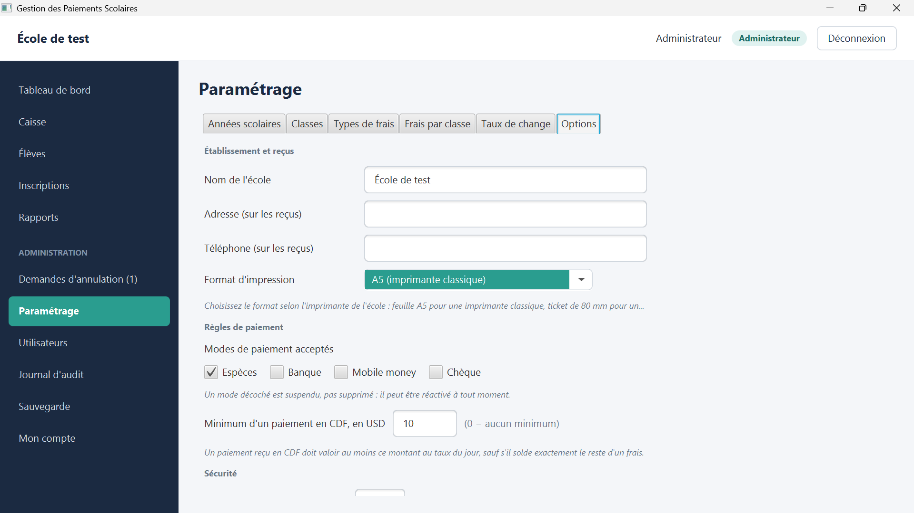

# Gestion des paiements scolaires

**Logiciel de gestion des paiements pour les écoles** : encaissement à la caisse, suivi du solde de chaque élève, reçus numérotés, rapports et sécurité des données.

> Projet personnel développé en **Java / JavaFX** avec une base **MySQL**, actuellement en phase de finalisation.

---

## Le problème

Dans beaucoup d'écoles, les paiements des frais scolaires sont encore notés dans des cahiers ou des tableurs : erreurs de calcul, reçus écrits à la main, difficulté à savoir combien chaque élève a déjà payé, et aucune trace fiable en cas de litige.

## Ce que le logiciel apporte

- **Un suivi fiable de chaque élève** : pour chaque frais, le montant, la remise, le montant payé et le reste à payer sont mis à jour à chaque encaissement.
- **Des reçus professionnels et numérotés** (par exemple `REC-2026-000010`), avec la situation du frais et un espace de signature pour le caissier et le parent. Format **A5** ou **ticket 80 mm** selon l'imprimante de l'école.
- **Deux devises gérées** : frais en francs congolais (CDF) ou en dollars américains (USD), avec conversion au taux de change du jour. Dans les rapports, chaque montant reste dans sa devise.
- **Des rapports prêts à l'emploi** : journal de caisse, impayés par classe et taux de recouvrement, exportables en **PDF** et en **CSV (Excel)**.
- **Des données protégées** : accès par compte, droits selon le rôle, protection contre les tentatives d'intrusion, sauvegarde et restauration de la base.
- **Une traçabilité complète** : journal d'audit des actions importantes et annulation de paiement encadrée.
- **Un usage en réseau local** : conçu pour fonctionner avec un ordinateur serveur et plusieurs postes de caisse dans l'école.

## Fonctionnalités

### Caisse
- Recherche d'un élève par matricule, nom ou prénom, pour l'année scolaire active
- Tableau des frais de l'élève : montant, remise, payé, reste
- Encaissement d'un paiement avec choix du frais, du montant reçu, de la devise et du mode de paiement
- Historique des paiements et des remises de l'élève
- Tableaux défilants horizontalement pour s'adapter à tous les écrans

### Paramétrage
- Années scolaires, classes et types de frais
- **Frais par classe** : plusieurs frais par classe, chacun dans sa devise
- **Taux de change**
- **Options de l'école** : nom, adresse et téléphone imprimés sur les reçus, format d'impression (A5 ou ticket 80 mm)
- **Règles de paiement** : modes acceptés (espèces, banque, mobile money, chèque), suspendus sans être supprimés et réactivables à tout moment ; montant minimum en USD pour un paiement reçu en CDF

### Élèves et inscriptions
- Enregistrement et consultation des élèves
- Inscription des élèves par classe et par année scolaire

### Annulation encadrée
- Seul l'administrateur peut annuler un paiement
- Le caissier peut envoyer une **demande d'annulation**, que l'administrateur valide ou refuse
- Les paiements annulés restent visibles dans les rapports mais ne sont pas comptés dans les totaux

### Administration
- Utilisateurs et rôles (administrateur, caissier), avec un menu adapté à chaque rôle
- Journal d'audit
- Sauvegarde et restauration
- Page « Mon compte »

## Sécurité

| Mesure | Objectif |
|---|---|
| Aucun mot de passe par défaut | Le compte administrateur est créé au premier démarrage |
| Blocage après 5 échecs de connexion | Empêcher les tentatives de devinette de mot de passe |
| Déconnexion automatique | Éviter qu'une session reste ouverte sur un poste de caisse |
| Droits selon le rôle | Chaque utilisateur n'accède qu'aux écrans qui le concernent |
| Journal d'audit | Garder la trace des actions importantes |
| Sauvegarde et restauration | Ne pas perdre les données de l'école |

## Captures d'écran

*Les données affichées sont des données de test.*

### Connexion

### Caisse

### Reçu de paiement

### Journal de caisse (export PDF)

### Rapports

### Paramétrage

## Technologies

| Domaine | Outils |
|---|---|
| Langage | Java 21 |
| Interface | JavaFX, FXML |
| Base de données | MySQL (13 tables et une vue de calcul des soldes) |
| Gestion du projet | Maven |
| Architecture | Couches séparées : DAO, services métier, contrôleurs, modèles |
| Environnement | Apache NetBeans |

## Code source

Le code source n'est pas public : ce dépôt présente le projet. Une démonstration est disponible sur demande, via mon profil GitHub.

## Auteur

**Lieke Monga Messi** : développeur d'applications junior, Kinshasa (RDC)
GitHub : [github.com/messi-dev7](https://github.com/messi-dev7)
